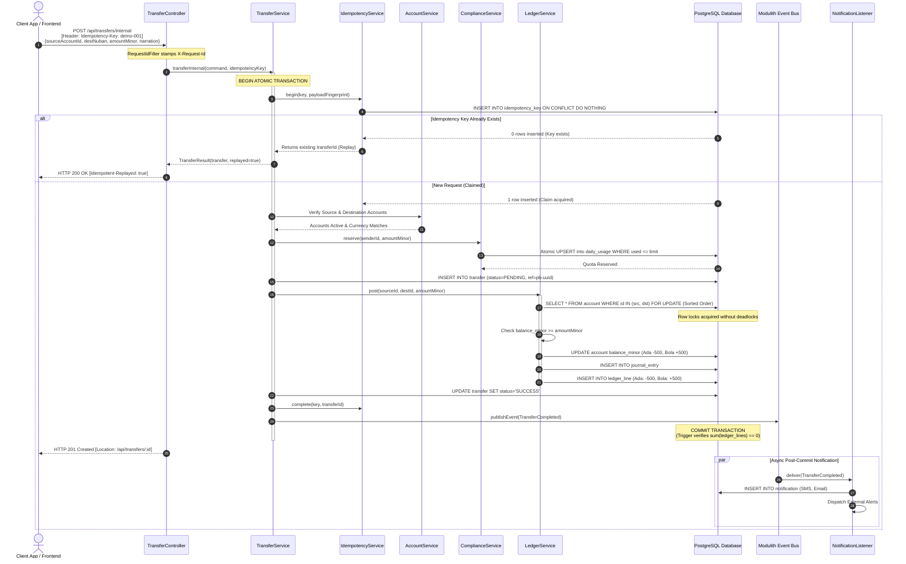
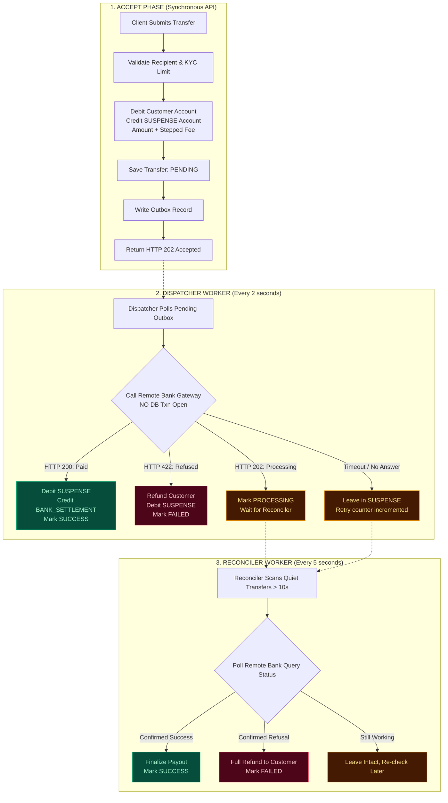
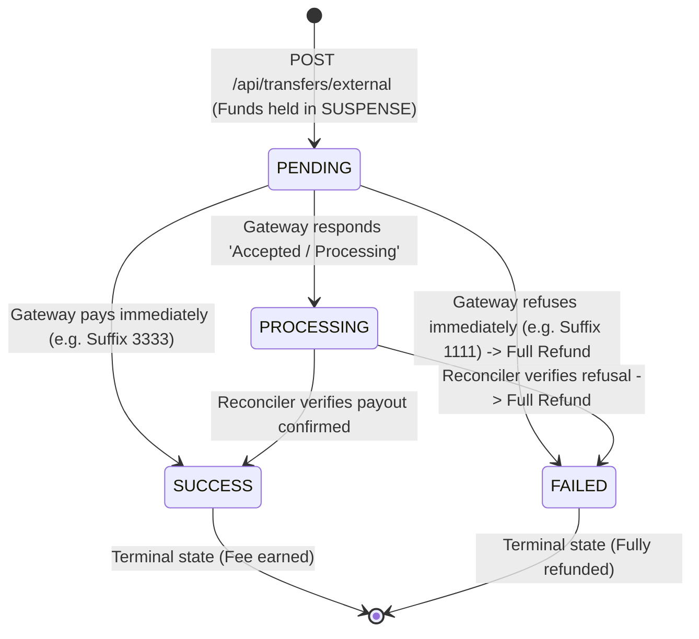

# PayBridge

[](https://spring.io/projects/spring-boot)
[](https://spring.io/projects/spring-modulith)
[](https://www.postgresql.org/)
[](https://react.dev/)
[](https://vitejs.dev/)
[](https://tailwindcss.com/)
[](LICENSE)

> **A production-grade Core Banking & Settlement Engine engineered as a Spring Boot Modular Monolith.**  
> Built to model real-world financial infrastructure: double-entry bookkeeping, zero-overdraft concurrency locking, strict idempotency, asynchronous outbox gateway dispatching, multi-bank reconciliation, and tiered AML compliance.

---

## Table of Contents

1. [Architectural Highlights](#-architectural-highlights)
2. [Module Architecture](#-module-architecture)
3. [Transfer Workflows & Flowcharts](#-transfer-workflows--flowcharts)
   - [1. Internal Account-to-Account Transfer](#1-internal-account-to-account-transfer)
   - [2. External Transfer with Simulated Gateway & Reconciler](#2-external-transfer-with-simulated-gateway--reconciler)
4. [External Bank Simulation (Deterministic Behavioral Profiles)](#-external-bank-simulation-profiles)
5. [API Specification](#-api-specification)
6. [Frontend Portal](#-frontend-portal)
7. [Getting Started](#-getting-started)
   - [Prerequisites](#prerequisites)
   - [1. Start Backend (Spring Boot + Postgres)](#1-start-backend)
   - [2. Start Frontend (React + Vite)](#2-start-frontend)
8. [Testing & Verification](#-testing--verification)
9. [Deployment (Render + Vercel)](#-deployment)

---

## 🏛️ Architectural Highlights

PayBridge is architected around foundational financial engineering principles:

* **Append-Only Double-Entry Bookkeeping:** Money is never created or destroyed out of thin air. Every movement is a balanced journal entry where debits and credits sum to zero ($\sum \text{lines} = 0$). PostgreSQL triggers enforce that `ledger_line` records can **never** be edited or deleted (`UPDATE`/`DELETE` prohibited).
* **Guaranteed Integer Kobo Arithmetic:** Floating-point numbers are prohibited in all money pathways. Values are stored as 64-bit signed integers in minor units (kobo: $100\text{ kobo} = ₦1.00$).
* **Pessimistic Row Locking in Canonical Order:** Simultaneous transfers between accounts acquire pessimistic write locks (`SELECT ... FOR UPDATE`) sorted strictly by Account ID. This mathematically eliminates deadlocks under heavy concurrent load.
* **Database Check Constraints as Second Defense Line:** Even if code-level validations fail, the Postgres table schema rejects negative customer balances via check constraint `ck_account_customer_not_negative`.
* **Cryptographic Request Fingerprinting & Idempotency:** The client provides an `Idempotency-Key` header. PayBridge computes a SHA-256 fingerprint over the transaction payload. Duplicate requests return `HTTP 200 OK` with `Idempotent-Replayed: true` and the original receipt without moving funds twice.
* **The Three Rules of External Settlement:**
  1. *Never call external banking APIs inside a database transaction* (holds locks and risks distributed split-brain).
  2. *A gateway timeout means "unknown", never "failed"* (funds remain safely quarantined in a `SUSPENSE` account).
  3. *Applying a bank's status must be idempotent* (reconciler queries can safely repeat without double payouts).
* **Spring Modulith Boundaries:** Code modules interact exclusively through documented public `api/` interfaces. Cross-module package leaks are caught at compile-time and verified by ArchUnit tests.

---

## 🧩 Module Architecture

PayBridge avoids distributed microservice overhead by enforcing hard modular boundaries within a single deployable monolith:

```
src/main/java/com/academy/paybridge/
├── customer/      # Onboarding, phone normalisation (+234), KYC verification tiers
├── account/       # Account lifecycle, check-digit NUBAN generation (bank-code: 999)
├── ledger/        # Append-only journal entries, lines, statement queries, dev funding
├── transfer/      # Internal transfer orchestration, external outbox dispatcher, idempotency
├── compliance/    # Atomic daily reservation upserts by KYC tier
├── notification/  # Asynchronous SMS & Email alerts delivered via domain events
├── shared/        # Immutable Money VO, RequestId MDC filters, CORS, GlobalExceptionHandler
└── [fx/remit/set] # Planned roadmap modules (Rate locking, cross-border remittance)
```

### Module Responsibilities

| Module | Responsibility | Public Interface | Persistence Tables |
|---|---|---|---|
| **`customer`** | Customer identity, phone normalisation, KYC tiers | `CustomerApi` | `customer` |
| **`account`** | Customer & System accounts (`FUNDING_SOURCE`, `SUSPENSE`), balances | `AccountApi` | `account`, `account_number_seq` |
| **`ledger`** | Balanced double-entry transactions, statements | `LedgerApi` | `journal_entry`, `ledger_line` |
| **`transfer`** | Internal transfers, external outbox, beneficiaries | `TransferApi` | `transfer`, `idempotency_key`, `beneficiary` |
| **`compliance`** | Tiered daily & per-transaction quota reservations | `ComplianceApi` | `daily_usage` |
| **`notification`**| Asynchronous customer alerts decoupled via Modulith events | `@ApplicationModuleListener` | `notification` |
| **`shared`** | `Money` value object, error codes, request correlation IDs | Core library | `event_publication` |

---

## 🔄 Transfer Workflows & Flowcharts

### 1. Internal Account-to-Account Transfer

An internal transfer moves funds between two accounts on PayBridge inside a **single atomic database transaction**.

#### Sequence Diagram



---

### 2. External Transfer with Simulated Gateway & Reconciler

External transfers interface with banks outside our perimeter. Because remote network calls can fail, hang, or delay, PayBridge uses a **3-Phase Outbox & Reconciliation Pattern**:

1. **Phase 1: ACCEPT (Instant Atomic Lock)** — Funds and stepped fees are quarantined from the sender into the bank's internal `SUSPENSE` account. A `PENDING` transfer and outbox dispatch stub are written, returning `HTTP 202 Accepted` in milliseconds.
2. **Phase 2: DISPATCHER (Background Worker, every 2s)** — Picks up pending outbox items and calls the remote bank gateway **strictly outside any database transaction**.
3. **Phase 3: RECONCILER (Background Detective, every 5s)** — Inquiries on transfers that remain unconfirmed for $>10\text{ seconds}$ to achieve eventual settlement or trigger automated refunds.

#### Architecture Flowchart



#### Transfer State Machine



---

## 🧪 External Bank Simulation Profiles

To test boundary conditions reliably without unpredictable third-party sandboxes, `FakeTransferGateway` deterministically drives gateway behavior via the **payee account number's last 4 digits**:

| Account Suffix | Bank Gateway Reaction | Resolution Mechanism | Final Status | Typical Timing |
|---|---|---|---|---|
| `...3333` | **Immediate Payout:** Remote bank accepts and pays | Dispatcher Worker | `SUCCESS` | $\sim 2\text{ s}$ |
| `...1111` | **Immediate Refusal:** Invalid account / blocked | Dispatcher Worker | `FAILED` *(Refunded)* | $\sim 3\text{ s}$ |
| `...1234` | **Accepted & Processing:** Bank queues payout | Reconciler Worker | `SUCCESS` | $\sim 14\text{ s}$ |
| `...5555` | **Timeout AFTER Receive:** Request processed but network dropped | Reconciler Worker | `SUCCESS` *(Paid exactly once)* | $\sim 19\text{ s}$ |
| `...2222` | **Timeout BEFORE Receive:** Bank never saw request | Reconciler Worker | `FAILED` *(Refunded)* | $\sim 34\text{ s}$ |
| `...9999` | **Name Enquiry Failure:** Account does not exist | Web Layer | `404 Not Found` | Instant |

---

## 📖 API Specification

All amounts are specified in integer **kobo** ($100\text{ kobo} = ₦1.00$).

### 1. Customers
* `POST /api/customers` — Onboard new customer (`firstName`, `lastName`, `email`, `phone`).
* `GET /api/customers/{id}` — Retrieve customer profile and KYC tier.
* `PATCH /api/customers/{id}/kyc-tier` — Update KYC tier (`UNVERIFIED`, `BASIC`, `FULL`).

### 2. Accounts
* `POST /api/accounts` — Open account with auto-generated check-digit NUBAN (`customerId`, `currency`).
* `GET /api/accounts/{id}` — Lookup account and cached balance.
* `GET /api/accounts/by-number/{accountNumber}` — Lookup account by 10-digit NUBAN.
* `GET /api/accounts?customerId={id}` — List all accounts for a customer.

### 3. Money Transfers
* `POST /api/transfers/internal` — Execute instant account-to-account transfer.
  * *Headers:* `Idempotency-Key: <unique-string>`
  * *Body:* `{"sourceAccountId": "uuid", "destinationAccountNumber": "1000000024", "amountMinor": 50000, "narration": "rent"}`
* `POST /api/transfers/external` — Accept transfer to external bank.
  * *Headers:* `Idempotency-Key: <unique-string>`
  * *Body:* `{"sourceAccountId": "uuid", "beneficiaryId": "uuid", "amountMinor": 100000, "narration": "invoice"}`
* `GET /api/transfers/{id}` — Poll outcome of transfer.
* `GET /api/transfers?accountId={id}` — List transfers for an account.

### 4. Beneficiaries (Name Enquiry)
* `POST /api/beneficiaries/resolve` — Perform name enquiry (`bankCode`, `accountNumber`).
* `POST /api/beneficiaries` — Save verified beneficiary.
* `GET /api/beneficiaries?customerId={id}` — List saved beneficiaries.

### 5. Ledger & Dev Scaffolding
* `POST /api/dev/accounts/{accountId}/fund` — Inject test funds via balanced ledger entry (`amountMinor`).
* `GET /api/accounts/{accountId}/entries` — Fetch chronological double-entry statement.

### 6. Compliance & Alerts
* `GET /api/compliance/customers/{customerId}/limits` — Retrieve daily usage and remaining limit.
* `GET /api/notifications?customerId={customerId}` — Retrieve SMS & Email event notices.

---

## 💻 Frontend Portal

The repository includes a modern React portal located in [**`paybridge front end`**](paybridge%20front%20end/):

* **Interactive 10-Step Demo Runner:** Executes the complete verification walkthrough from `DEMO-GUIDE.md` directly inside the browser with side-by-side terminal logs.
* **Instant Idempotency Testing:** Includes dedicated buttons to submit identical requests twice, visually demonstrating `HTTP 200 OK` replays and `Idempotent-Replayed: true` headers.
* **Live Settlement Monitor:** Real-time polling widget showing external transfers moving through `PENDING` $\rightarrow$ `PROCESSING` $\rightarrow$ `SUCCESS`.
* **In-App Render Connection Tool:** Built-in modal to wake sleeping Render instances and test network latency.

---

## 🚀 Getting Started

### Prerequisites
* **Java 25** (or Java 21 LTS)
* **Docker Desktop** (for containerized PostgreSQL)
* **Node.js 18+** & npm (for frontend)

---

### 1. Start Backend

1. **Start PostgreSQL container:**
   ```bash
   docker compose up -d
   ```
2. **Run Spring Boot application:**
   ```bash
   ./mvnw spring-boot:run
   ```
   *The backend will boot on port `8080` and run Flyway migrations 1 through 8 automatically.*

3. **Verify backend health:**
   ```bash
   curl -s http://localhost:8080/actuator/health
   # Expected output: {"status":"UP"}
   ```

---

### 2. Start Frontend

1. **Navigate to the frontend directory:**
   ```bash
   cd "paybridge front end"
   ```
2. **Install dependencies:**
   ```bash
   npm install
   ```
3. **Launch dev server:**
   ```bash
   npm run dev
   ```
4. **Open in browser:** [http://localhost:3000](http://localhost:3000)  
   *(Vite's reverse proxy automatically forwards all `/api/*` calls to `http://localhost:8080`).*

---

## 🧪 Testing & Verification

PayBridge includes automated test suites covering modularity, business rules, and multi-threaded race conditions:

```bash
# Run all automated tests
./mvnw clean test
```

### Key Test Suites

* **Concurrency Race Tests (`ConcurrencyTest.java`):** Fires 40 and 200 simultaneous threads attempting concurrent withdrawals to prove zero negative balances occur.
* **Duplicate Request Race (`DuplicateRequestRaceTest.java`):** Spawns concurrent HTTP requests using the same `Idempotency-Key` to verify only one transfer executes and the rest receive idempotent replays.
* **Modularity Verification (`ModularityTests.java`):** Verifies Spring Modulith boundaries, ensuring zero unauthorized inter-module dependencies exist.
* **External Gateway Lifecycle (`ExternalTransferTest.java`):** Tests outbox dispatch, timeout handling, and automated refunds across all suffix profiles.

---

## 🌐 Deployment

PayBridge is configured for deployment with a decoupled infrastructure topology:

| Tier | Host | Configuration File | Notes |
|---|---|---|---|
| **Backend API** | [Render](https://render.com) | [`render.yaml`](render.yaml) | Docker runtime with PostgreSQL database blueprint |
| **Frontend UI** | [Vercel](https://vercel.com) | [`vercel.json`](paybridge%20front%20end/vercel.json) | Vite build with edge rewrites proxying `/api/*` to Render |

Detailed deployment guides:
* [Frontend Vercel Deployment Guide](paybridge%20front%20end/VERCEL-DEPLOYMENT.md)
* [Backend Render Demo Guide](DEPLOYED-DEMO-GUIDE.md)

---

## 📜 License

Distributed under the MIT License. See [LICENSE](LICENSE) for more information.
